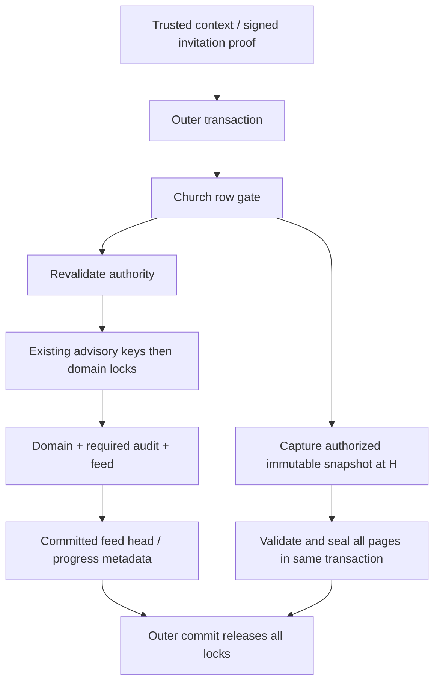

# COMPAT-01 B4-P1 — Recovery safety proofs and implementation design

2026-10-16, Asia/Taipei. **YELLOW: STAKEHOLDER REVIEW REQUIRED.** Parent/current HEAD `7ace0096d3a8baceaeb698ea47b398a2bbc4ea8f`, branch `feat/mvp-foundation`. This is an unstaged test/documentation candidate. No production recovery, migration, contract, retention-policy, crypto-format, IndexedDB-schema or worker-policy change. B1–B3 remain preserved. P2/B5/B6/Late/Pack06, publication, merge and deployment are unauthorized.

## 1. Authority, evidence and limits

The stakeholder approved B4's architecture direction and selected P1 execution only. Approved recovery scope is today plus the previous89 church-local dates and every older session referenced by preserved drafts/events/conflicts. Older cached records are not automatically removed. Uncertain originals retain their encrypted intent, IDs, payloads and base versions for authorized audited review. Feed90/receipt180 policies remain unchanged. A15-minute snapshot lifetime is not approved.

Labels: **VERIFIED** is source/runtime evidence; **PROPOSED** is unimplemented design; **NOT TESTED** is an unqualified future scenario; **BLOCKED** names its missing prerequisite. A successful proof runner collects deliberately failing baseline assertions; it is not GREEN product qualification.

Source fixtures: [runner](../../scripts/compatibility/recovery-proofs/run.mjs), [server](../../scripts/compatibility/recovery-proofs/server.php), [workers](../../scripts/compatibility/recovery-proofs/worker.php), [browser](../../scripts/compatibility/recovery-proofs/browser.ts), [negative invariants](../../scripts/compatibility/recovery-proofs/invariant.mjs), [reproduction instructions](../../scripts/compatibility/recovery-proofs/README.md).

Final evidence location and validation totals are recorded in section10 after qualification. All previous attempts remain ignored evidence, including runner setup/module errors and fixture failures. No result from a failed aggregate is described as a clean aggregate pass.

## 2. Isolation and preservation boundary

**VERIFIED:** the launcher inspects the protected PostgreSQL container/volume, then creates an independently initialized PostgreSQL18 cluster on a new volume and internal network with unique setup/runtime/test identities. The new cluster system identifier differs from the protected cluster. No database port is published. PHP shares only that new PostgreSQL network namespace; database host127.0.0.1 therefore identifies the disposable cluster. The browser listener binds127.0.0.1 on an ephemeral port.

The PHP guard executes before autoload/Laravel/test bootstrap. It rejects missing isolation markers, foreign identities, non-loopback database hosts, inherited database URLs and a `/work/.env`. A read-only setup connection independently verifies the server identifier, database, setup identity and PostgreSQL18 before allowing baseline schema initialization. Runtime configuration is rechecked after bootstrap. The runtime is NOSUPERUSER/NOBYPASSRLS/NOCREATEDB/NOCREATEROLE; relevant tenant tables have enabled and forced RLS. Unscoped runtime reads return no churches.

Only tracked API inputs are copied into a disposable source directory (279 inputs at entry). Vendor dependencies are archived read-only from the retained B3 runtime; no private environment is copied. The setup-only identity owns the new database; application requests/workers use the restricted identity. Workers inherit initialized configuration and never rerun the credential-rotating bootstrap. The original bootstrap remains unchanged.

Independent scenarios reset only this isolated database and its asserted array cache. Cache reset prevents one scenario's real throttling bucket contaminating another; no rate-limit value, assertion or production cache changes. Test kernel authentication is designated synthetic Teacher access in Laravel testing mode. Normal-session/CSRF/MFA/CAPTCHA qualification is not claimed. Owner correction uses the actual Owner domain authorization and revision path in the same disposable tenant.

No existing browser profile is opened. Browser contexts are fresh and nonpersistent. Actual encryption uses the existing600,000-iteration PBKDF2/PIN-wrapped AES-GCM key path. The existing cursor table contains plaintext operational metadata; the report does not pretend that its cursor row itself is encrypted. It is compared together with real encrypted attendance and authorization records.

## 3. Five runtime safety findings

### B4-01 — Missing attendance and false completion

**Source:** [bootstrap](../../apps/api/app/Http/Controllers/OfflineBootstrapController.php), [SyncRecovery](../../apps/web/src/features/synchronization/sync-recovery.ts), [saveBootstrap](../../apps/web/src/offline/profile-store.ts), [SyncClient](../../apps/web/src/sync/sync-client.ts), [status projection](../../apps/web/src/features/synchronization/sync-status.ts).

The browser creates a real encrypted draft; its creation is accepted by actual server synchronization and settled through the actual receipt. A subsequent server marking becomes Present while the local draft remains Unmarked. Actual retention deletes the91-day-old required feed after the authorization expires, before scheduled device cleanup. Bootstrap renews authorization and clears recovery metadata without attendance. With all feed rows gone, `MAX(sequence)` also returns0; preserving the existing local cursor avoids that particular regression but cannot recover missing rows. Existing synchronization completes its surviving pages and the shared status function reports `Synchronization complete` while local state remains Unmarked and server state Present.

The proof targets the current client engine/status function, not a mocked completed result. No screenshot of a new product UI or physical installed transition is claimed.

### B4-02 — Served progress is not applied progress

**Source:** [PullChanges](../../apps/api/app/Domain/Sync/PullChanges.php), [retention](../../apps/api/database/migrations/2026_09_29_000004_create_operations_infrastructure.php).

A real pull advances the server cursor but its response is deliberately not passed into client application. The real local cursor/draft/events and encrypted authorization remain exact. Pruning behind the served cursor removes the unapplied row despite active authorization. The independent no-advance control retains the unseen row. This proves the retention risk, rather than merely comparing synthetic cursor numbers.

### B4-03 — Receipt expiry destroys deterministic original classification

**Source:** [ApplySyncBatch](../../apps/api/app/Domain/Sync/ApplySyncBatch.php), [conflict classifier](../../apps/api/app/Domain/Attendance/DetectAttendanceConflict.php).

Matching surviving receipts return Duplicate/Accepted. After actual180-day receipt pruning, retrying the same accepted original is freshly Accepted, indistinguishable by that result from a genuinely never-applied event whose target already coincidentally matches. After real finalization and an Owner correction to Absent, another expiry/retry of that original yields a fresh attendance conflict. The original acceptance did not change; the evidence was lost and the current path reevaluated intent.

This does not assert that every audit history is identical or that a particular durable guest identity can never supply evidence. It establishes that receipt absence/current-state equality is insufficient for a general safe classification. No fabricated acceptance receipt is used.

### B4-04 — Allocation order differs from commit order

**Source:** [publication](../../apps/api/app/Domain/Attendance/PublishAttendanceChange.php), [feed schema](../../apps/api/database/migrations/2026_09_29_000001_create_sync_infrastructure.php), [pull](../../apps/api/app/Domain/Sync/PullChanges.php).

Two independent restricted-runtime workers publish actual valid attendance representations in open transactions for different sessions. IPC pauses A after allocation; B commits first. The client pulls through B, A commits, and the next pull skips A's lower sequence although its row still exists. Backend PIDs/transaction IDs and commit barriers are retained. No sleep decides the interleaving.

A **test-only** church-row lock acquired before domain work makes B wait: `pg_blocking_pids` positively observes A blocking B. After A commits, B allocates later. Another church publishes while the wait exists. This proves the local ordering control, not integration across every production mutator. Existing publications are not patched in P1.

### B4-05 — Prepared download overwrites a newer local draft

**Source:** [applyPull](../../apps/web/src/sync/sync-client.ts), [ordinary edit CAS](../../apps/web/src/features/attendance/attendance-repository.ts), [profile transaction](../../apps/web/src/offline/db.ts).

Actual SyncClient preparation pauses at its encryption dependency before the write transaction. An independent IndexedDB connection uses the actual AttendanceRepository to save Absent and an original pending event. Resuming the prepared Present download overwrites that newer draft; the original Absent event remains intact. The failure is stale projection overwrite, not invented event deletion. The positive control pauses an ordinary edit instead: its existing stored-ciphertext/version comparison rejects that stale edit.

No future recovery generation exists yet; the reproduced primitive demonstrates why one is required. Independent connections are not proof of a physical multi-window upgrade.

## 4. Publisher and mutation/lock coverage

**VERIFIED current map; PROPOSED coordination additions:**

| Entry/owner | Current boundary and locks | Required P2 coordination |
|---|---|---|
| [ApplySyncBatch](../../apps/api/app/Domain/Sync/ApplySyncBatch.php) | Outer transaction; sorted event/record advisory keys; session/record locks; nested per-event savepoints; publication and receipt inside outer commit | Church gate before advisory locks; atomic committed-head update after publication; refusal rolls back entire protected request |
| [FinalizeAttendance](../../apps/api/app/Domain/Attendance/FinalizeAttendance.php) | Nested transaction, session then regular records; publication currently performed by sync caller | Reentrant gate before locks; preserve caller's audit/feed transaction and identify any independent caller |
| [CorrectAttendance](../../apps/api/app/Actions/Attendance/CorrectAttendance.php) | Outer transaction, record advisory key, session then record, revision/audit/feed | Gate before advisory key |
| [ResolveConflict](../../apps/api/app/Actions/Attendance/ResolveConflict.php) | Advisory key; conflict then record then session; revision/audit/feed | Gate before advisory key; retain existing internal order once serialized |
| [ResolveAttendanceGuest](../../apps/api/app/Actions/Guests/ResolveAttendanceGuest.php) | Advisory session key; sorted guests then session; records/student/enrollment; audit/feed | Gate before existing locks; promotion also changes roster/scope projection |
| [ManageTeachers](../../apps/api/app/Actions/Memberships/ManageTeachers.php) / TeacherManagementController | Existing church FOR UPDATE then memberships/assignments; direct targeted tombstone publication | Reuse first church gate; update committed head for every tombstone, not only attendance upserts |
| [RevokeTeacher](../../apps/api/app/Actions/Memberships/RevokeTeacher.php) / [TransferOwnership](../../apps/api/app/Actions/Memberships/TransferOwnership.php) | Church then membership/user/assignment and authorization/session changes | Same gate before all existing mutations; recheck actual Owner under it |
| [AcceptTeacherInvitation](../../apps/api/app/Actions/Invitations/AcceptTeacherInvitation.php) | Signed-proof tenant context; church then invitation/user/membership; assignment grant | Preserve signed-proof authority and acquire same gate first; no caller-selected tenant authority |
| [RosterController](../../apps/api/app/Http/Controllers/RosterController.php) | Ministry/student/enrollment mutations in transactions; ministry/student row locks; no roster change feed | Gate before row locks; bootstrap scope fingerprint must cover these changes |
| [CommitStudentImport](../../apps/api/app/Domain/Imports/CommitStudentImport.php) | Import batch then sorted rows; students/enrollments; transactional audit | Gate before batch lock; preserve idempotent commit/retry and counts |
| [OfflineBootstrapController](../../apps/api/app/Http/Controllers/OfflineBootstrapController.php) / lease issue | Tenant outer transaction, lease upsert/audit, cursor upsert | Separate renewal from reconstruction; snapshot gate before mutable reads/progress writes |
| [SyncController](../../apps/api/app/Http/Controllers/SyncController.php) / PullChanges | Tenant transaction; authorized scan; device cursor lock; lease issue | Gate before scan/filter/cursor lock; input evidence only; full refusal remains non-settling |
| [PruneOperationalData](../../apps/api/app/Jobs/PruneOperationalData.php) / [PurgeRevokedDeviceData](../../apps/api/app/Jobs/PurgeRevokedDeviceData.php) | Narrow SECURITY DEFINER functions; tenant iteration; separate scheduled functions | Same per-church coordination inside functions, ordered churches, atomic flags/watermarks before deletion |

Church application approval creates a new church in one transaction, before an existing recovery snapshot can exist. Platform health, notification delivery, invitation preview and read-only reports do not mutate snapshot attendance/roster and do not acquire a new gate merely because they are tenant-related. No existing platform church-status/timezone update route was found; a future one must join the ownership map before implementation.

### Proposed lock order and transaction diagram

Choose the **existing church row FOR UPDATE** as the first coordination candidate, avoiding a second advisory-lock hierarchy/hash namespace. After initial trusted-context resolution, acquire it before any existing domain/advisory/progress locks; then revalidate active church/membership/role/assurance. Nested calls are reentrant in the same database transaction. Do not acquire it only at publication after earlier locks: that can introduce inversion.

Pruning takes church gates in UUID order. Never enter a second church while holding an unordered first church gate. Runtime requests remain single church. PostgreSQL foreign-key checks can block behind FOR UPDATE even for unrelated writes in that church; the test only proves different-church independence. Same-church throughput/contention and every mutation interaction require P2 qualification. Do not silently substitute a different locking scheme if measurements fail.

The cut proof is: every relevant earlier transaction has committed/rolled back before capture gets the gate; every later publisher obtains it after snapshot commit and allocates its sequence afterward. Domain/audit/feed/head roll back together. No sequence-contiguity assumption is made. Snapshot projection reads occur after the gate; a stale REPEATABLE READ snapshot acquired before waiting is not sufficient. Keep the existing outer isolation unless a specifically tested change is necessary.

## 5. Exact PROPOSED persistent definitions — no migration executed

All new timestamps use `timestamptz(6)`. Cursor/head/floor values are signed PostgreSQL bigint with `CHECK(value >= 0)` and decimal-string wire encoding. UUIDs are native uuid. Digests are char(64) with lowercase hexadecimal checks. These are definitions for one future reviewed additive migration; not runtime DDL or permission to backfill protected data.

### Existing device_cursors additions

| Field | Definition / initialization |
|---|---|
| applied_cursor | bigint NULL, nonnegative; **NULL for every existing row**, never copied from cursor |
| applied_generation | uuid NULL; evidence epoch, not a capability or authorization |
| applied_scope_digest | char(64) NULL; binds the scope represented by this baseline |
| applied_evidence_at | timestamptz(6) NULL |
| receipt_coverage | varchar(8) NOT NULL DEFAULT 'unknown'; CHECK IN ('unknown','complete','pruned') |
| receipt_coverage_since | timestamptz(6) NULL; only trustworthy tracked admission start |
| receipt_pruned_through | timestamptz(6) NULL; maximum actual deleted receipt receive-time |
| active_recovery_id | uuid NULL |

Add UNIQUE(church_id,membership_id,device_id) for run FK binding. CHECK applied_cursor/generation/scope/evidence timestamp are either allNULL or allnonNULL. CHECK complete coverage requires coverage_since; pruned requires receipt_pruned_through; unknown does not fabricate a coverage start. Existing runtime SELECT/INSERT/UPDATE and forced RLS remain; no new broad DELETE grant. Evidence updates use locked compare-and-set logic; database CHECK alone does not prove monotonicity. Cursor reset across a newly authorized recovery epoch is permitted only with complete reconstruction, never by a plain pull response.

### sync_recovery_progress — one row per church

`church_id uuid PRIMARY KEY REFERENCES churches(id)`, `feed_head bigint NOT NULL CHECK >=0`, `baseline_sequence_floor bigint NOT NULL CHECK >=0`, `pruned_through bigint NULL CHECK >=0`, `coverage_epoch uuid NOT NULL`, `history_baselined_at timestamptz(6) NULL`, `updated_at timestamptz(6) NOT NULL`; CHECK pruned_through IS NULL OR pruned_through<=GREATEST(feed_head,baseline_sequence_floor). Primary key is the index.

`feed_head` records committed publication after the coordinated baseline and includes retained committed rows, not a raw sequence allocation. **Never seed it from device_cursors.cursor:** current PullChanges accepts a syntactically valid client cursor without a feed-head bound, so historical served metadata can contain an unissued future value. This is a VERIFIED source limitation, not an additional P1 runtime reproduction.

One-time PROPOSED cutover requires separately authorized draining/stopping of all old server writers, not merely acquiring a lock old processes ignore. With no old transaction or cached sequence consumer able to commit later, initialize feed_head from retained church MAX(sequence) or0; initialize baseline_sequence_floor from the existing global sequence's allocated floor(last_value if is_called, otherwise0), without resetting the sequence. The floor can include rolled-back allocations; it is explicitly a cutover fence, **not** claimed committed attendance. Snapshot H is GREATEST(feed_head,baseline_sequence_floor). New coordinated publishers allocate above that fence and transactionally advance feed_head. Legacy local cursors are rebaselined only after complete authorized snapshot application in the new epoch.

`pruned_through=NULL` means prior deletion coverage is unknown. Do not initialize it to0 and claim complete historical retention. Every legacy device requires a reconstructed baseline before receiving trusted applied evidence. If a verified writer drain is unavailable, initialization is BLOCKED; do not infer it from MAX(sequence), wall time or arbitrary served values. That operational dependency needs separate approval before deployment; P1 performs no cutover.

### offline_recovery_runs

`id uuid PRIMARY KEY`; `church_id uuid NOT NULL`; `membership_id uuid NOT NULL`; `device_id uuid NOT NULL`; `actor_id bigint NOT NULL REFERENCES users(id)`; `request_id uuid NOT NULL`; `local_generation_id uuid NOT NULL`; `generation uuid NOT NULL`; `state varchar(16) NOT NULL`; `scope_digest char(64) NULL`; `manifest_digest char(64) NULL`; `snapshot_cursor bigint NULL CHECK>=0`; `window_start date NULL`; `window_end date NULL`; `timezone varchar(64) NULL`; `input_page_count integer NOT NULL DEFAULT 0 CHECK>=0`; `output_page_count integer NULL CHECK>=0`; `output_item_count bigint NULL CHECK>=0`; `created_at timestamptz(6) NOT NULL`; `sealed_at timestamptz(6) NULL`; `expires_at timestamptz(6) NOT NULL`; `client_confirmed_at timestamptz(6) NULL`.

CHECK state IN ('collecting','ready','client_confirmed','expired','superseded'); expires_at>created_at; window_start=window_end-89 when sealed. Ready/confirmed requires all sealed fields and a complete manifest; client_confirmed requires confirmation timestamp. `generation` is UNIQUE; UNIQUE(church_id,id); UNIQUE(church_id,membership_id,device_id,id); UNIQUE(church_id,membership_id,device_id,request_id) for begin idempotency. FK(church_id,membership_id,device_id) REFERENCES device_cursors(church_id,membership_id,device_id). Actor must be revalidated against the membership's user under lock; a user FK alone is insufficient. Add indexes(church_id,membership_id,device_id,created_at) and(expires_at,state).

Add the composite active_recovery FK from device_cursors(church_id,membership_id,device_id,active_recovery_id) to runs' corresponding unique key. Insert the run after its device row exists, then switch active_recovery_id in that transaction. A new generation supersedes the previous one; old tokens cannot clear its hold.

### offline_recovery_pages

`church_id uuid NOT NULL`; `run_id uuid NOT NULL`; `kind varchar(6) NOT NULL CHECK IN ('input','output')`; `ordinal integer NOT NULL CHECK>=0`; `item_count integer NOT NULL CHECK BETWEEN0 AND100`; `plaintext_bytes integer NOT NULL CHECK BETWEEN0 AND1048576`; `content_digest char(64) NOT NULL`; `payload_ciphertext text NOT NULL`; `created_at timestamptz(6) NOT NULL`; PRIMARY KEY(church_id,run_id,kind,ordinal); FK(church_id,run_id) REFERENCES offline_recovery_runs(church_id,id). No cascading deletion of original domain/audit/work records. Ciphertext limit accounts for envelope expansion; enforce <=2MiB. Split large logical sessions into typed fragments instead of truncating them.

Input pages hold encrypted bounded manifests/original descriptors while collecting; output pages hold immutable snapshot fragments. Seal validates ordinal continuity, complete counts, unique identities and ordered page digests. No output is readable as a ready snapshot before the sealing transaction commits. Use existing server encryption facilities without replacing APP_KEY; browser data continues using the existing profile envelope.

### RLS, grants and immutable transitions

On all three new tables: ENABLE and FORCE RLS; trusted church policy USING and WITH CHECK `church_id=NULLIF(current_setting('app.current_church_id',true),'')::uuid`; REVOKE ALL FROM PUBLIC. Runtime receives SELECT/INSERT on runs/pages and SELECT/INSERT/UPDATE on progress. Run lifecycle updates use a narrow tenant-bound transition function with validated predecessor state and immutable binding; payload/page updates are never granted. A trigger rejects UPDATE of pages and sealed identity/manifest fields. Cleanup DELETE is only through a narrow fixed-search-path maintenance function that verifies terminal/expired state, church scope and active-run references. It never deletes local originals or canonical audit evidence. Setup identity remains separate.

Pruning and cleanup capabilities require review equivalent to existing SECURITY DEFINER functions: fixed pg_catalog search_path, explicit qualified objects, no PUBLIC execution, allowlisted runtime execution, restored transaction-local church scope and no RLS bypass granted to runtime.

Rollback is additive/fail-closed: preserve metadata/pages needed by actual clients; disable new entry while retaining safety refusals. Never drop recovery tables, reset flags or restore unsafe bootstrap/pruning as an automatic down migration after use. Any destructive rollback requires separate authorization and a recovery plan.

## 6. PROPOSED API, pagination and snapshot/feed contract

No existing OpenAPI/generated client is modified in P1. Future changes are confined to the existing bootstrap/pull resource family and typed recovery refusals; no blanket v2/426, new registry, encryption version or dedicated acknowledgment endpoint.

1. `POST /offline/bootstrap` action `begin`: device_id and an idempotency request UUID start a collecting generation after current session/CSRF/tenant/role/assurance checks. Server-derived actor/membership/church are authoritative. Return run identity, generation, bounded manifest limits and expiry. Repeated same request binds to the same run; changed contents refuse.
2. Same resource action `manifest`: run/generation, ordinal, previous-page digest and bounded original descriptors/session references. Compute event hashes with the existing server canonicalization of the original push projection; do not assume JS JSON hashing matches PHP Unicode escaping. Persist only encrypted temporary input and the necessary classification bindings. Duplicate identical page is idempotent; mismatched duplicate refuses. A submitted final manifest declares total input pages/items/digest so omitted references cannot be silently treated as complete.
3. Same resource action `seal`: under the church gate, recheck current authority, validate the complete input manifest, select today through today-89 in church timezone plus every older authorized local reference, capture H, construct effective attendance and immutable output pages, and seal atomically. No lease/response means received/applied acknowledgment. Interrupted sealing rolls back its entire output generation.
4. `GET /offline/bootstrap?device_id=...&recovery_id=...&page=...`: opt-in output page with generation, schema discriminator, ordinal/counts/digest, cutH, window and expiry. Reauthorize and verify scope fingerprint on every request. Response is no-store/private, correlated, bounded, nonstreaming at each page boundary. Current authorization supersedes old snapshot permissions. Scope/roster changes invalidate the generation; no cached response may expose revoked attendance.
5. Existing `GET /sync/pull`: optional opaque continuation bound to actor/church/membership/device/generation/scope/cursor. The candidate sends it only after complete local application. Server credits the **input** applied cut, not its newly returned page. A recovery continuation can clear recovery-required only for the active complete generation. Repeated request is idempotent. Legacy requests cannot clear a recovery hold or supply trusted applied evidence merely by naming a cursor.

Header `X-MSprout-Attendance-Reader` retains B3's approved semantics; it is not silently expanded. Unknown recovery/page schema and unknown attendance refuse safely. Typed409 missing-history/uncertainty responses contain no per-event terminal settlement and never masquerade as401/403.

### Proposed wire definitions to review before P2

All POSTs retain CSRF/session protection. Required request fields are:

- Begin: `{action:'begin', device_id:uuid, request_id:uuid, local_generation_id:uuid}`. The local generation is a correlation/fencing value, never trusted ownership.
- Manifest: `{action:'manifest', device_id:uuid, recovery_id:uuid, generation:uuid, ordinal:integer>=0, previous_digest:hex64|null, references:[{session_id:uuid,ministry_id:uuid,attendance_date:date}], events:[SyncPushEvent], final?:{page_count:integer,reference_count:integer,event_count:integer,manifest_digest:hex64}}`. Sum of reference/event items <=100; canonical encoded page <=1MiB. Payloads use the original immutable projection, not regenerated events. Final manifest cannot be sealed until declared pages/counts/digest match.
- Seal: `{action:'seal', device_id:uuid, recovery_id:uuid, generation:uuid, manifest_digest:hex64}`.

Use200 for idempotent successful operations. Begin returns `{recovery_id,generation,state:'collecting',actor:{id},lease,authorized_ministry_ids,expires_at,page_item_limit:100,page_byte_limit:1048576}`. Renewing this lease does not clear the recovery hold or change an applied cursor. Persist it only with an incomplete/recovery marker; ordinary cached-data readers must remain fenced until authorized scope reconciliation. The existing PIN/data key may prepare the manifest after matching online identity verification; no revoked cached roster is displayed merely because a lease renewed.

Manifest response `{recovery_id,generation,ordinal,digest,received_item_count}` acknowledges only temporary manifest intake, not synchronization or event acceptance. Seal returns `{recovery_id,generation,state:'ready',scope_digest,manifest_digest,snapshot_cursor,window_start,window_end,timezone,page_count,item_count,expires_at}`.

Page query uses `device_id,recovery_id,page` with zero-based output ordinals. Required response fields are `{schema:'attendance-recovery-v1',recovery_id,generation,ordinal,page_count,item_count,total_item_count,page_digest,manifest_digest,snapshot_cursor,scope_digest,expires_at,items,next_page}`; item_count is this page's count and total_item_count matches the sealed manifest. next_page is integer or null and must agree with ordinal/count. Items are discriminated ministry/student/session/record/guest/reference-disposition/receipt-evidence fragments with parent identities and complete per-session counts. No silent fragment omission is allowed. Final page alone additionally carries `completion_continuation`; possession is not proof of durable application. The client stores/submits it only after validating and committing every fragment. Manifest digest is SHA256 over the ASCII domain prefix `MSprout:recovery-manifest:attendance-recovery-v1\n` followed by ordered hex page digests joined by newline. Page digests use the single canonical server encoding; input digests returned by the server are retained by the client. Reject duplicate identities with conflicting contents and any count/order mismatch. Shared OpenAPI fixtures must establish canonicalization; integrity digests are not authorization.

Pull adds only optional `continuation` to current cursor/limit query. The opaque signed continuation binds the exact prior applied range and active generation; ordinary responses additionally provide the next continuation for atomic local storage. Preserve legacy response compatibility through an explicit opted-in variant; do not add mandatory fields to legacy readers. A response token is not accepted as proof that that same response was already applied.

Proposed safe errors: retain409 `full_bootstrap_required` and `attendance_compatibility_required`; add409 `recovery_generation_expired`, `recovery_generation_superseded`, `recovery_scope_changed`, `recovery_manifest_mismatch`, `event_reconciliation_required`. Retain400 reader-declaration errors and legitimate401/403; malformed input422; oversized page413. Use the existing correlated safe envelope and no-store/private headers. Refused operations return no terminal event results, new receipts, cursor jumps or recovery completion. These literal names/types remain PROPOSED, not a contract modification performed in P1.

Scope fingerprint includes active membership/role, current authorized ministries and assignment relationships, ministry activity/version, minimal authorized roster/enrollment projection, church status/timezone and the captured date basis. No roster feed currently exists; student/import/guest promotion changes therefore require fingerprint-based invalidation/reconstruction rather than inventing a new roster feed. Performance of these checks requires P2 load proof.

Reconstruction uses effective latest correction ordering(revised_at,id), session status/version/finalized metadata, complete regular records, guest status plus resolved_student_id/merged_into_guest_id, and minimal authorized display context for historical records. Today's enrollment list must not replace a historical session's records. Missing server targets do not imply an event was rejected/unapplied. Inaccessible targets receive a non-disclosing restricted classification, with original local intent locked/preserved. Open conflict state/provenance remains separate from transfer completion; free-form audit/correction/guardian/birthdate data is not copied unnecessarily.

### Applied progress and pruning invariants

Serving H does not apply H. A complete encrypted local baseline plus its cut/continuation is committed before any confirming pull. Server application evidence assumes the conforming client follows that ordering; it is not cryptographic proof of disk writes or an authorization grant.

Prune under the gate using actual applied evidence for eligible active devices. Before deleting, atomically record the highest actually deleted church sequence and mark affected devices recovery-required. Recovery-required devices can be excluded from incremental protection only after a reconstructable fail-closed path exists. Pin a sealed generation's needed post-H feed while it remains valid; expiry ends the pin but cannot clear recovery-required. NULL prior-history coverage is conservative. Numeric gaps/other churches/filtered rows never prove deletion. Reject unissued/out-of-range pull cursors and stale epochs before progress writes; neither historical served metadata nor caller-selected future numbers can raise the new committed head. Prune receipt rows only after marking the affected device's coverage pruned and recording its maximum actually deleted receive-time. Preserve90/180 minimum policies and exact equality behavior.

## 7. PROPOSED local generation and uncertainty boundaries

Reuse current IndexedDB tables/envelopes: encryptedBlobs for purpose-bound staging/server baseline/review classifications; metadata only for non-PII operational generation/revision fences. No schema/encryption-version bump. A shared writeForProfile transaction must compare the captured local generation/revision before applying stale prepared work. All relevant local writers/settlement/recovery paths must join that check. Existing ordinary edit CAS remains intact. Crypto stays outside transactions; key/profile/lease/generation checks repeat inside.

After all snapshot pages/fragments validate, one transaction over profiles, encryptedBlobs, attendanceDrafts, outboxEvents, conflicts, serverCursors and metadata commits reconstructed authoritative projections, scope handling, encrypted authorization/continuation, cutH and completed local generation, with syncNeedsPull=true. Original unsynchronized drafts/events/base versions remain exact; authoritative downloaded baseline is stored separately where necessary. Previously cached older data is preserved subject to current access restrictions. Missing local authorized sessions are materialized. Later feed pages must also handle newly materialized sessions; retaining the current `if(!stored) continue` as the only projection path would invalidate recovery.

Crash before commit keeps prior live state; crash after it keeps a complete H baseline and incomplete catch-up. A concurrent edit either commits before capture and is included in the manifest, or fails/retries the stale preparation check; never overwrite it silently. Previously settled acknowledgments and earlier committed pages are not recreated or falsely rolled back. Browser/engine/lease expiry, lock and profile-switch abort staging without erasing original work. Cross-version old tabs are a B5 prerequisite, not solved by adding a field that old code ignores.

| Evidence/classification | Permitted handling |
|---|---|
| Matching surviving receipt + original actor/hash | Original accepted/duplicate/conflict/rejected result; preserve original identity |
| Known complete tracked receipt coverage + no receipt | Fresh evaluation under existing scope/version/security rules |
| Pruned or unknown coverage + no receipt | Original remains unresolved; no automatic replay/settlement/deletion or replacement ID |
| Equal current target | Insufficient proof; no guessed acceptance |
| Target corrected by another device | Retain effective correction/provenance and original intent; no automatic restore |
| Revoked assignment | Current server data not disclosed; original intent restricted and retained for authorized review |

Legacy coverage initializes unknown; elapsed offline time/client timestamps do not establish completeness. A new post-cutover device may start complete only when server admission/receipt tracking is complete from its first event. Once pruning creates a gap, unknown IDs cannot be assumed fresh. This conservative policy can require review of legitimate new-looking work; P1 does not promise unlimited automatic replay with finite receipts.

Future reviewer procedure: inspect surviving authoritative evidence, classify uncertainty truthfully, obtain current Owner authority/assurance for a specifically chosen new domain action, preserve original intent and record a distinct audited disposition linked to its original identity. A new action is not a replacement original event or fabricated historical receipt. Teacher visibility, authority after role changes, unresolved-case ownership and exact disposition/retention policy require a separate tooling decision. P1 builds no Owner resolution screen/endpoint and cannot claim uncertain work is automatically resolved.

## 8. Lifetime evaluation and future invariant matrix

The workload fixture measures100/1,000/10,000 synthetic sessions with30 records each: JSON serialization, existing real AES-GCM encryption and actual IndexedDB staging in each engine. It models transfer from measured plaintext bytes at64kbit/s,256kbit/s and1Mbit/s. Those link times are arithmetic, not real network observations. Server snapshot-capture time, wire/compression overhead, local final-transaction cost and physical mobile performance remain NOT TESTED.

Do not select15minutes merely because a small fixture fits. Recommend the lifetime only after adding construction + actual transfer + local validation/commit + bounded retry margin for the supported workload. Freeze generation content; do not extend an expired authorization by extending snapshot lifetime. Slow/large transfers must retain local originals and resumable unexpired staging; expired generations restart truthfully without a cursor jump. If repeated expiry prevents the supported workload from completing, qualify a longer reviewed lifetime or different bounded transfer design before rollout. New snapshot payload retention is a separate privacy/operational decision; it is not an extension of feed90/receipt180 policy.

**Measured current-host results (final environment-isolated run):** plaintext sizes are398,401 /3,984,010 /39,840,100bytes for100 /1,000 /10,000 sessions. Chrome155 serialization/encryption/staging takes97.0 /547.6 /3,638.6ms; WebKit26.6 takes303 /4,134 /41,722ms. These are observations, not stable benchmarks; the earlier diagnostic run was faster. For the largest payload, modeled transfer alone is4,980.0s at64kbit/s,1,245.0s at256kbit/s and318.7s at1Mbit/s. A15-minute absolute generation cannot support that64kbit/s workload even without retries.

**PROPOSED qualification candidate:** test a configurable four-hour absolute snapshot lifetime for this workload envelope, rather than ship15minutes. Two64kbit transfers plus25% margin already consume about3.46hours before unmeasured server/mobile costs. Four hours is a candidate to validate, not an approved production SLA or proof that every workload fits. Slow/large connections beyond the qualified envelope must remain resumable or truthfully blocked, never silently truncated. Preserve the existing five-minute profile idle lock: persist encrypted staging and resume after the original PIN/current online authorization; do not keep keys unlocked to meet a transfer target. Bound every effective authorization by the legitimate lease expiry, regardless of snapshot lifetime. Final lifetime, supported link/dataset envelope and temporary server-payload retention need stakeholder approval plus P2 measurements.

| Invariant | P1 evidence | Required P2 proof |
|---|---|---|
| No false complete after pruned history | B4-01 current-client witness | Authoritative90-day+referenced reconstruction and truthful statuses |
| Served is not applied | B4-02 plus retained active-floor control | Piggyback evidence, lost responses, actual prune coordination |
| No guessed old acknowledgment | B4-03 replay/correction witnesses | Coverage initialization, atomic pruning marker and non-settling uncertainty |
| No late sequence behind cutH | B4-04 and test-only church ordering | Every mapped publisher/mutator, rollback, deadlocks, sustained contention |
| No stale local overwrite | B4-05 plus ordinary CAS control | All local writers, generation recovery, crash and multi-tab cases |
| Real cutoff semantics | SQL exact equality/±1second and89/90/91,179/180/181 | Candidate functions retain those policies with active/expired/unknown evidence |
| Tenant isolation | Restricted role, forced RLS, unscoped denial | Full cross-tenant reads/writes/pages/receipts and role/assignment races |
| Immutable complete pagination | No implementation in P1 | Gaps, duplicates, tampering, partial pages, expiry, retry, oversized sessions |
| Preserve security and compatibility | Unchanged production source/B1–B3 evidence | B2/B3 unknown-state/non-settling, auth/assurance/lease/key binding |
| Installed-client transition | NOT TESTED | Genuine B1 legacy assets with B5 candidate, windows/workers/offline reopen |

## 9. Bounded P2 ownership and approval gates

**PROPOSED, NOT AUTHORIZED:** one coordinated implementation candidate would own:

- One new additive migration for section5, reviewed replacements of the two narrow operations functions, and restricted recovery model/repository code. Existing historical migrations remain unchanged.
- A small reentrant church coordination helper, the mapped attendance/membership/roster/import entry paths, and feed publication/head updates. No general domain rewrite or unrelated navigation/refactor.
- Bootstrap/recovery run/page orchestration, SyncController/PullChanges/ApplySyncBatch guards and receipt coverage. Existing OpenAPI/generated client must change together in that future task.
- Profile store/database write fences, SyncClient/server-base projection/outbox integration and both existing recovery callers. No PWA activation, profile deletion, key reset or encryption-format change.
- Focused tests, immutable-page/load/security/contract/browser qualification, current knowledge and the recovery report. New UI is limited to truthful recovery/uncertainty feedback and requires actual visual acceptance if presentation materially changes.

Order: approve exact design/ownership; prove negative cases; implement metadata/coordination/prune markers; implement immutable authorized snapshot; implement atomic local reconstruction/catch-up; qualify all affected gates; complete review and stop for required approval. Do not bundle new Owner resolution tooling, B5 installed transitions, B6 review, Late or packs.

Remaining decisions: exact supported dataset/link envelope and lifetime; acceptance of same-church locking/contention footprint; precise new refusal schema and recovery contract; operational cutover for unknown legacy history; safe rollback/deployment sequencing; and separately scoped reviewer tooling. If safe coverage requires a broader schema/mutation redesign or a permanent replay ledger/new event-admission protocol, STOP with the exact dependency rather than expanding P2.

## 10. Final qualification, inventory and preservation

**Qualified reproduction run:** `.git/msprout-compat-b4-p1-20261016/c0373d6869/`; complete launcher transcript `attempt-10.log`. All five findings are REPRODUCED. Its `results.json` records eight actual Node assertion subprocesses with exit1: server B4-03/04 plus Chrome and WebKit B4-01/02/05. The parent runner exits0 only because its witness/control collection succeeded. This is deliberately failing-before evidence, not eight passing product safety tests.

Isolation record: fresh container `msprout-b4-p1-c0373d6869-postgres`, volume `msprout-b4-p1-c0373d6869-data`, system identifier `7697257178459250727`, database `p1_c0373d6869_test`, setup role `p1_setup_c0373d6869`, runtime `p1_runtime_c0373d6869`. The separate PHP container has only P1 source/dependency/proof/evidence mounts. `isolation.json`, `runtime-isolation.json`, `source.json`, `fixture-source.json` and `browser-environment.json` establish identity and inputs. No secret values are reported.

Final server-only closure `server-qualified-final.log` in the same parent evidence directory adds explicit own/foreign scoped-read and42501 cross-write controls. It rechecks both server mechanisms, real cutoff equality/day boundaries and strengthened coordination: the different-church worker also acquires its own church gate while A blocks B. It uses the already verified disposable `91ef4d1e54` cluster. Its added RLS assertions and formatting do not change seed/request/browser code or application inputs; Chrome/WebKit proof/build evidence remains valid by effect. Final source hashes and closure receipt distinguish those final fixture inputs from the earlier full-run seal. No expensive B1–B3 application suite was repeated.

| Gate | Actual final outcome / limits |
|---|---|
| B4-01,02,05 current module execution | Chrome155.0.8059.80 and native WebKit26.6: each mechanism reproduced, zero page errors; ordinary edit CAS/active-floor/original-event controls pass |
| B4-03,04 runtime | Real kernel/receipts/corrections and independent runtime workers reproduce both; test-only gate control passes; no production gate integrated |
| SQL retention | Equality and-1second deleted,+1second retained; feed89 retained/90&91 deleted; receipt179 retained/180&181 deleted; prune-before-cleanup flag gap observed |
| Isolation controls | Distinct system/volume/namespace; restricted roles and forced RLS; unscoped0, own1/foreign0, cross-write42501; invalid marker/host/worker configuration rejected before bootstrap(exit255) |
| Fixture syntax/type/lint | PHP syntax, Node syntax, strict standalone browser TypeScript, repository TS lint and explicit Node lint pass; fixtures remain outside ordinary CI discovery |
| PHP style | Pint test passes for the two fixture PHP files; scratch formatting touched only P1 copies |
| OWASP scan | Semgrep1.177.0,98 rules, all six script-directory inputs,0 findings and0 errors in the final applicable scan; original two B3 parser warnings remain historical limitations, not fixed |
| Secrets/references/whitespace/scope | Exact candidate source/docs scan, reference checks, whitespace and final inventory are sealed in ignored P1 validation receipts; no ignored runtime artifacts belong in the candidate |
| Prior application suites | B1–B3 evidence retained only by unchanged production/test/contract/dependency/workflow inputs; no new hosted candidate exists |
| Future recovery, installed transition | NOT IMPLEMENTED / NOT TESTED; five existing safety defects remain open |

### Failed-attempt ledger and closure reasoning

- Attempt01: temporary PostgreSQL initialization socket reported ready before final startup. No Laravel bootstrap ran. Readiness now requires TCP, which is unavailable on the temporary initialization server.
- Attempt02: Docker archive API could not copy the existing tmpfs vendor path. Replaced by read-only tar streaming; no protected environment copied and no bootstrap ran in that attempt.
- Attempt03: fixture lacked an initial kernel Request before creating the session guard. Added only the synthetic test Request. Ordinary application authentication was unchanged.
- Attempt04:±1microsecond boundary fixture collapsed under the existing timestamp(0) schema. Exact whole-second cutoff/±1second controls now pass, plus day windows; no cutoff policy weakened.
- Attempt06: Windows ESM import required a file URL. Corrected runner module resolution only.
- Attempt07: Playwright was a transitive package, not a direct resolvable dependency. Use installed `@playwright/test` exports; no dependency installed/upgraded.
- Initial strict TS check caught a fixture method-name typo(countPending); corrected to the existing repository method. Initial Node lint needed the browser-evaluate global declaration; no application/test assertion changed.
- Attempt08: persistent test application's real throttling cache contaminated independent scenarios. Reset only the asserted array cache on scenario reset; retain all real limit values.
- Attempt09: all witnesses completed, but Vite defaults could load existing `.env.local`; retain this run as diagnostic, not the final environment-isolated qualification. Final attempt10 explicitly disables envDir/envFile, verifies resolved envDir=false and removes inherited VITE keys. No protected file was altered. The API/test cluster isolation was independently valid throughout. Final build emits one informational deprecation warning for redundant envFile=false; active envDir=false is asserted. This is separate from historical parser/CRLF limitations.
- A later worker-identity closure used inet::text, which includes `/32`; it failed its strict loopback check. `host(inet_server_addr())` now verifies the same bare loopback address without relaxing database/role/port checks. Successful closure is retained separately; failed closure is not called a pass.

### Exact candidate inventory

Seven new paths:

1. `scripts/compatibility/recovery-proofs/run.mjs` — guarded standalone launcher and isolated runner configuration.
2. `scripts/compatibility/recovery-proofs/server.php` — actual kernel/retention/receipt fixtures and RLS controls.
3. `scripts/compatibility/recovery-proofs/worker.php` — independent runtime transactions and IPC barriers.
4. `scripts/compatibility/recovery-proofs/browser.ts` — real encrypted client/storage proofs and measured workload.
5. `scripts/compatibility/recovery-proofs/invariant.mjs` — explicit intentionally failing baseline assertions.
6. `scripts/compatibility/recovery-proofs/README.md` — reproduction and evidence limits.
7. `docs/qa/compat-01-b4-p1-recovery-safety-design.md` — this evidence/design proposal.

Three modified paths: `knowledge/CURRENT_STATE.md`, `knowledge/ROADMAP_STATUS.md`, `knowledge/TESTING_ENVIRONMENT.md` — concise selected-task/result/hold updates; historical bodies preserved. Total **10 paths: seven new and three modified**. No application, existing test, API contract, migration, dependency, workflow, AGENTS or canonical policy file changes.

Protected-resource final verification is in `preservation-final.json`: original657 tracked inputs differ only in the three listed knowledge files; private2/backups10/local-QA30 and11 stashes remain preserved; fresh read-only fingerprints cover39 development tables/runtime role; both frozen B1 builds retain16 assets each. Feature checkpoint/main/other-worktree branch and empty staging remain verified. Only new labelled P1 Docker resources/volumes were created; existing volume/containers were not reconfigured or removed. Generated resources and all initial attempts are retained; no destructive cleanup was performed. Deliberate protected database observations were read-only preservation checks, never fixture targets.

**Final review:** no unresolved harness BLOCKING/SHOULD FIX item; five confirmed product recovery defects remain deliberately uncorrected in this proof-only task. Same-church contention, coordinated server cutover, precise recovery contract/schema, temporary snapshot lifetime/load envelope and separate reviewer tooling remain approval/implementation dependencies. No recovery method is claimed proven by design alone.

**COMPAT-01 B4-P1 — YELLOW: STAKEHOLDER REVIEW REQUIRED.** Nothing staged, committed, pushed, merged or deployed. STOP; await explicit stakeholder direction. P2/B5/B6/Late/Pack06 remain untouched.
